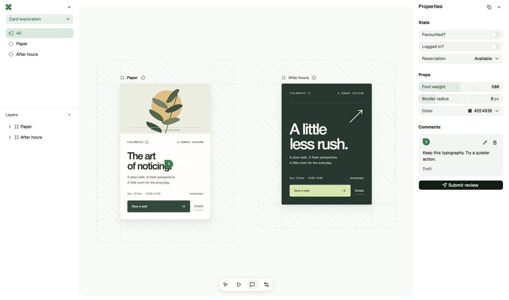

<p align="center">
  
</p>

<p align="center">
  xuui is a local canvas for reviewing the UIs your agents build.<br />
  Try real React components, compare alternatives, and point at what to change.
</p>

<p align="center">
  <a href="https://www.npmjs.com/package/@getxuui/xuui"></a>
  <a href="LICENSE"></a>
  <a href="#give-your-next-design-a-canvas"></a>
</p>

<p align="center">
  <a href="https://xuui.com">Website</a> ·
  <a href="docs/authoring.md">Documentation</a> ·
  <a href="https://xuui.com/agents.md">Agent guide</a>
</p>

<p align="center">
  <a href="docs/assets/studio.jpg"></a>
</p>

## Try the UI, then point at the detail

A useful design review means trying the interactions, comparing the details, and showing exactly what should change. Your agent puts working React components on the canvas so you can do all three.

Use **Play** to try a design, **Select** to inspect its layers, or **C** to pin a comment to an element. **Submit review** collects your feedback for the agent. Copy it into chat, or connect [MCP](docs/mcp.md) to let the agent read it directly.

## Keep the thinking behind each direction

A **study** explores one design question through several **variants**, each with a description and rationale. Compare them on one canvas, then have your agent develop the next direction from your review.

Keep earlier component implementations so the alternatives stay runnable. Submitted feedback stays with the designs it refers to, giving the next round its context.

## Give your next design a canvas

Install the companion [`/present` skill](https://github.com/getxuui/skills), then ask your agent to present the UI you are working on:

```sh
npx skills add getxuui/skills
```

The [agent guide](https://xuui.com/agents.md) covers setup and the optional MCP connection. To create a study yourself:

```sh
npx --package @getxuui/xuui@alpha xuui init my-study
cd my-study
npx xuui dev
```

Open the printed local URL. The alpha supports standalone React study workspaces, with their own components, styles, data, and dependencies. Requires Node 22.12 or newer. **Experimental alpha; breaking changes expected.**

[Authoring](docs/authoring.md) · [Canvas controls](docs/controls.md) · [Changelog](CHANGELOG.md)

<details>
<summary>Work on xuui itself</summary>

```sh
npm ci
npm run dev
```

Run `npm run check` for the package build, browser tests, and installed-package checks. Use [issues](https://github.com/getxuui/xuui/issues) to report bugs or discuss changes.

</details>

Use [Conventional Commits](CONTRIBUTING.md) for commits and pull request titles. `npm ci` enables local commit message validation.

[MIT](LICENSE) · Robin Humphreys
